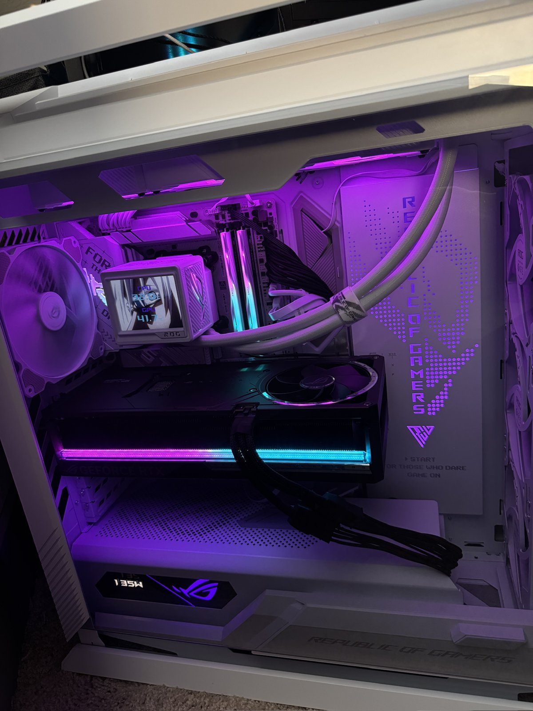
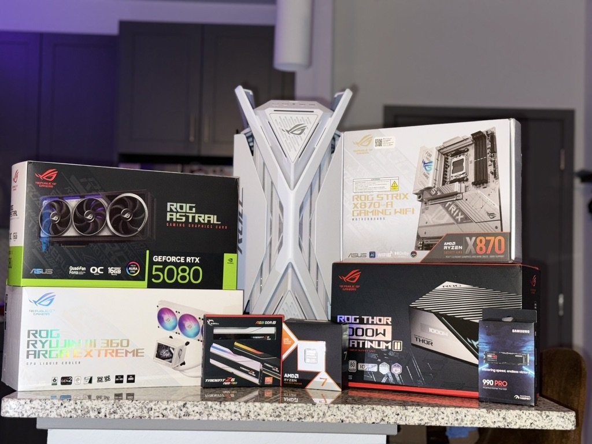
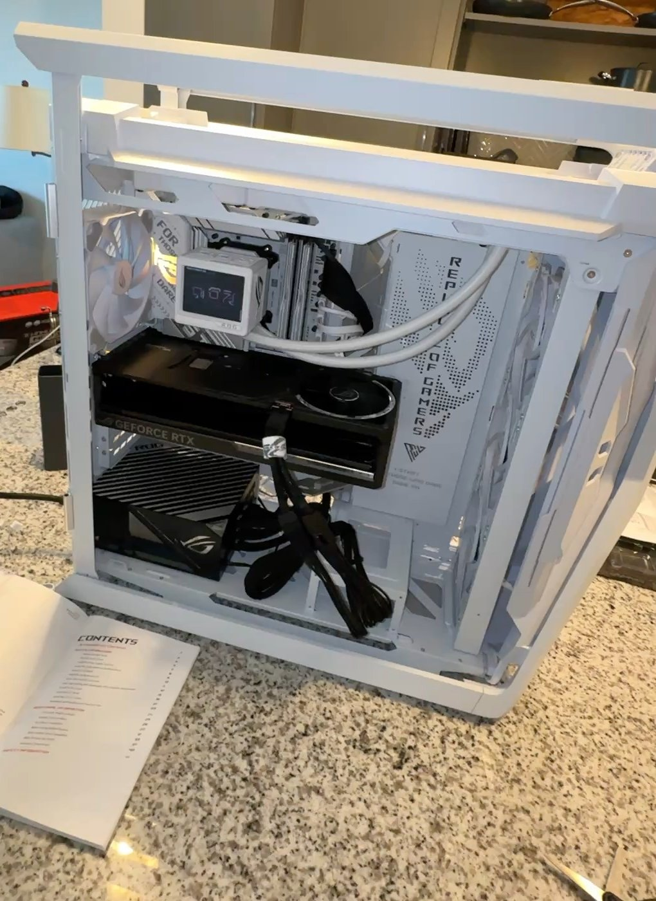

# Gaming PC — April 2025

My personal gaming PC, which I planned, assembled, configured and troubleshot myself. The main issue was system freezes caused by unstable memory settings. I traced it to the motherboard firmware and RAM profile, then fixed and validated it.

## Parts

| Component | Part |
|-----------|------|
| CPU | AMD Ryzen 7 9800X3D |
| Motherboard | ASUS ROG Strix X870-A Gaming WiFi (AM5) |
| Memory | G.SKILL Trident Z5 Neo RGB 64 GB (2 × 32 GB) DDR5-6000 CL26 |
| Graphics | ASUS ROG Astral GeForce RTX 5080 OC (16 GB) |
| Storage | Samsung 990 Pro 4 TB NVMe SSD |
| Power supply | ASUS ROG Thor 1000W Platinum II |
| CPU cooling | ASUS ROG Ryujin III 360 ARGB Extreme (360 mm AIO liquid cooler) |
| Case | ASUS ROG Hyperion GR701 (white) |
| Operating system | Windows 11 Pro |

## Build log

1. **Planning:** chose an AM5 platform (X870 chipset) around the Ryzen 7 9800X3D. Paired it with a 1000W Platinum power supply, which leaves headroom for the RTX 5080.
2. **Assembly:**
   - Installed the CPU, the two RAM modules and the NVMe SSD on the motherboard.
   - Mounted the 360 mm AIO radiator and pump block.
   - Installed the GPU.
   - Routed and managed the power and front-panel cabling.
3. **First boot:** confirmed that the BIOS detected the CPU, all 64 GB of RAM and the SSD.
4. **Operating system:** created a Windows 11 Pro installation USB drive and did a clean install onto the 990 Pro.
5. **Drivers and configuration:**
   - Installed the chipset and GPU drivers.
   - Enabled the RAM's EXPO profile to run it at its rated DDR5-6000.

## Troubleshooting: system freezes with the RAM profile enabled

**Symptom:** with the memory's EXPO profile enabled (DDR5-6000), the whole system froze while gaming, and sometimes at random times outside of games. The only way to recover was a hard reset.

**Diagnosis:**
- The freezes only happened with the EXPO memory profile active at DDR5-6000.
- A full-system hang that needs a hard reset, with no crash message, points to memory instability more than to a driver or software problem.
- DDR5 high-capacity kits on new AM5 platforms often depend on motherboard firmware maturity for memory training and stability.

**Fix:**
1. Updated the motherboard BIOS to a newer version.
2. Re-enabled EXPO after the update, since a BIOS update resets the memory settings.
3. Tested the memory at different settings and speeds before settling on the final configuration.

**Validation:**
- Stress-tested the system after the changes.
- Followed up with extended real-world use (long gaming sessions).
- No freezes since. The RAM runs stable at its rated DDR5-6000.

**What I took from it:**
- Change one variable at a time.
- Rule out firmware before blaming hardware.
- Don't call a fix done until it holds up under both stress testing and normal use.

## Result

- **Stable:** the system runs reliably with the RAM at its rated speed.
- **Temperatures:** in the finished-build photo, the cooler's display shows the GPU at about 42 °C.
- **Power:** in the same photo, the power supply's display reads about 135 W.
